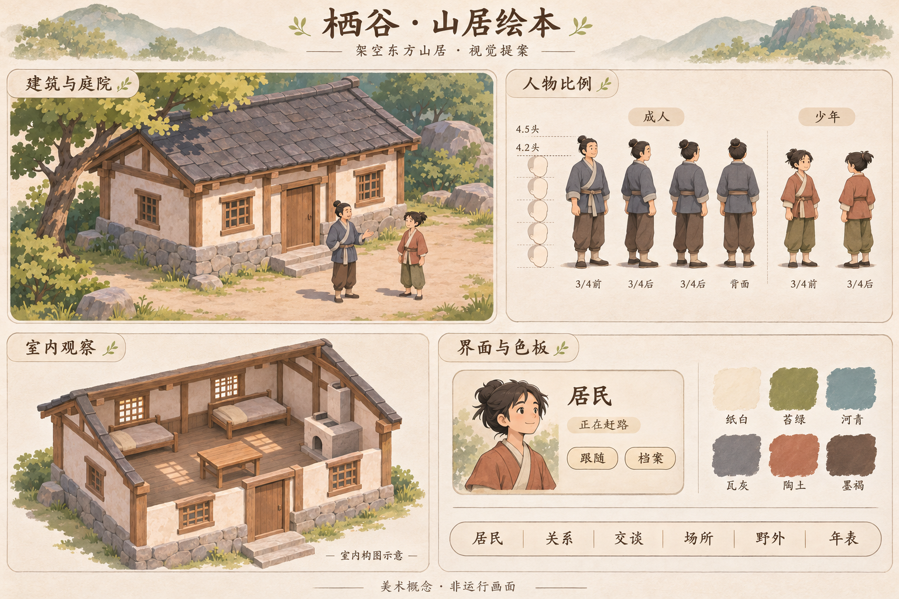

# 栖谷绘本式微缩山谷视觉提案

[返回游戏设计](README.md)

以**架空东方山居**为建筑与服装基调，把栖谷做成可以走近观察的微缩绘本：房屋朴素，草木安静，人物清楚，日常行动有分量。第一眼看见山谷的整体关系，第二眼能找到一个具体的人，继续看时能明白此刻发生了什么。

方向沿用已选概念图。下列地图资产、尺度、动效与性能数字仍是制作目标；绘本UI布局已接入默认观察入口，见实现与验证边界（旧客户端实现已退役；设计意图保留）。首批只制作一处真实共屋及周边、两位居民和有限室内；用实际运行样板决定是否扩展全镇。

规范板用于对齐材质、人物体量和界面气质。图中人物转身不是合格的四方向素材，室内家具数量与位置是构图示意，字形与色块也不是最终界面规范；制作时分别以下文、真实房间布局和实际字号为准。[早期全景概念](assets/storybook-valley-concept-v1.png)保留整体氛围，其中灯光、炊烟、物资、作物和人物动作不作为世界事实。

## 画面的主次

三条规则贯穿所有素材：**地面安静，人物清楚，建筑成组。**

地面以完整的土路、草坪和河岸色块形成空间。纹理集中在墙脚、树根、石缝和水边；可走区域保留大片低细节表面。屋顶先读到明暗面，再读到少量瓦缝。树先读到树冠外形，再读到三四组叶丛，避免每片叶子都争抢注意力。

建筑用门廊、屋顶体量和院落开口建立辨识度。人物的头发、上衣与手部在背景前保持清楚轮廓，姓名仅在指向、选中和跟随时出现。选中的人得到一个轻薄的脚下标记，其他居民继续自然生活。

画面保留手工的轻微不齐：木梁边缘、石基排列、墙面色差。轮廓、透视和光源保持一致。质感来自局部笔触与结构，不能靠全屏噪点、泛黄滤镜或厚重描边取得。

## 视角与尺度

采用固定斜俯视，地面使用现有的 **2∶1 菱形投影**。镜头可以平移、缩放和跟随，首批不旋转。建筑的两组水平边服从同一投影；人物脚底、门槛、树根和家具落点均有明确锚点。

| 项目 | 首批制作目标 | 用途 |
| --- | --- | --- |
| 成人体型 | 约 4.5 头身，头与手略放大 | 小尺寸下读清朝向与动作 |
| 少年体型 | 约 4.2 头身，身高按实际年龄与个体设定调整 | 11—15 岁的初始居民保留少年感 |
| 默认观察距离 | 成人画面高度约 48—64 CSS px | 同屏理解院落与数位居民 |
| 聚落概览 | 成人约 24—32 CSS px，压低衣纹与面部细节 | 先看路线、建筑和人口分布 |
| 跟随近景 | 成人约 72—96 CSS px | 阅读手部动作、门槛和室内活动 |
| 门洞 | 视觉净高约为成人身高的 1.2—1.35 倍 | 防止人如玩偶、房如巨物的比例失衡 |
| 资产绘制 | 按默认显示尺寸至少 2 倍制作 | 留出清晰缩放空间，输出尺寸经样板校准 |

上述屏幕尺寸需与真实共屋占地、可见范围一起校准；不为了构图改动地图格数、建筑尺寸或通路。现有逻辑格仍是 32×16 投影单位，高清画稿尺寸与世界单位分别管理。

开场镜头沿真实道路和河岸组织视线，将共屋、两位居民和一个活动地点纳入同屏。远处山林可作为无交互的边缘背景，但不得覆盖或伪造可探索地图。横屏保留开阔的院落，竖屏通过重新取景靠近人物。

## 色彩与材质

以灰绿、浅土和暖白为大面积颜色，陶土与蓝灰作为居民的识别色。饱和度最高的色块只占小面积。下列色值是晴日中性基准，材质在光照下允许变化；界面文字不随世界昼夜变色。

| 名称 | 基准色 | 主要用途 |
| --- | --- | --- |
| 纸白 | `#F4ECD9` | 面板、阅读底色 |
| 墨褐 | `#3E382F` | 正文、图标、主要轮廓 |
| 嫩苔 | `#B0B88B` | 草地大色块 |
| 深苔 | `#70866C` | 树冠、灌木、少量衣物 |
| 河青 | `#71999A` | 水面基色 |
| 灰石 | `#B6AEA0` | 石基、踏步、河岸岩石 |
| 灰瓦 | `#777477` | 主屋顶、少量远景 |
| 浅墙 | `#E5D7BB` | 抹灰墙面、布料亮部 |
| 旧木 | `#80624C` | 梁柱、门窗、家具 |
| 陶土 | `#A4664F` | 局部瓦顶、衣服、陶质结构细节 |
| 冷影 | `#55596B` | 低透明度的背光与接触阴影 |
| 警示赭红 | `#A6493E` | 已有伤病、危险或失败的必要提示 |

主光统一来自画面左上方。接触阴影比投影更深，脚底、墙根和家具下方必须稳稳落地。远景降低对比与细节，居民周围保留明度差。禁止全场同强度黑描边、塑料高光与大范围光晕。

木材先有梁柱结构，再有少量顺纹；墙面是轻微起伏的灰泥；瓦片先成片，再以边缘少量错位增加手感；石基用大小有差别的石块组织，不沿每条缝描黑。纸纹主要留在空白与边缘，正文下方接近平整。

## 建筑与山谷

建筑语言来自日常山居：木构、浅色抹灰、石基、灰瓦与少量陶瓦。屋面以简单双坡为主，檐口轻微舒展。优先表现遮雨、采光、进出和共同生活的需要，控制飞檐、雕饰和装饰性符号的数量。

| 类别 | 外观识别重点 | 绘制边界 |
| --- | --- | --- |
| 住宅 | 小体量双坡屋顶、单门、局部门廊 | 户型与实际占地相容 |
| 共屋 | 较宽屋面、清晰入口、可容人停留的门前空间 | 首个样板建筑，院落不改变通行 |
| 工坊 | 深一点的檐口、较大的工作开口、朴素梁架 | 工位与工具另依设施记录绘制 |
| 商店 | 较宽门脸、简洁窗格、可辨店面轮廓 | 有商店不等于有货架、现货或室内交易 |
| 诊所 | 明亮墙面、清楚入口、安静的外观 | 家具和照护状态分别读取记录 |
| 学堂 | 稍整齐的开窗节奏、舒展的公共入口 | 活动人数与授课行为以现场为准 |
| 畜舍 | 更宽实用的门洞、木构体量 | 栏位、动物、饲料分别对应实物 |
| 温室 | 轻框架和透光围护的简化轮廓 | 作物、成熟度和存量不能作为装饰补满 |

第一批只画共屋，其余类型共享材质规则后再扩展。房屋差异优先来自体量和开口，再来自屋顶颜色，避免每栋都靠一套新装饰建立身份。

河水以宽缓色带、少量沿流向的亮纹和岸边接触变化表达。水面可有环境相位，鱼群、船只和可渡位置必须来自数据。草只在边缘结簇；资源植物有自己的轮廓与状态，装饰草不能伪装成可采物。桥面、踏步和道路对齐真实通路，避免画出无法到达的捷径。

## 居民与服装

居民是长时间观察的主角。每位居民至少有三个稳定识别点：发型轮廓、上衣主色、衣服外形。衣料采用棉麻的柔软色块，常用短褂、简洁交领内衫、宽松长裤、朴素布鞋；裙装、围裙等作为个体衣装选择，不自动绑定性别或职业。

初始九人的外观继续尊重已有 `appearance` 数据。新增发型与服装细节通过稳定的身份映射保存，刷新、换房间和切换视图后保持一致。地图人物与档案头像使用同一身份参考。当前颜色字段不足以完整定义新造型，需要补一份展示层角色表。

苏葵、高禾、葛川在初始设定中分别为 13、15、11 岁；采用少年比例与姿态，不沿用早期全景图里幼童般的体型。葛慈的 68 岁设定可以体现在面部与发色，但驼背、拄杖、虚弱和病态需要个体设定或状态依据。年龄未知时保留未知，不通过绘制幼儿外形替系统作判断。

职业经验不等于终身职业，也不决定当前手里的道具。工具在需要且有依据时出现。工作结束后回到居民自己的衣装轮廓，不能让木工永远扛木头、种植经验者永远提水壶。

首批先做一位成人与一位少年，校准身高、手部和门洞。规范板中的两人是造型示意；绑定具体居民前核对已有外观，再制作对应头像与真正的四向图。

## 动作与状态

动作节奏温和，变化主要发生在肩、肘、手和重心。待机不持续上下弹跳，劳动不依靠夸张挥舞和发光粒子。动画帧率与世界时间分别处理。

| 动作或状态 | 画面规则 | 首批目标 |
| --- | --- | --- |
| 待机与自选停留 | 稳定重心、偶发微小动作，活动说明区分原因 | 每方向 2 帧，允许长时间保持静止 |
| 行走 | 脚步落地、轻微摆臂；实际停止时停步 | 四方向，每方向 6 帧，约 8—12 帧/秒 |
| 现场劳动 | 到达实际工作点后才进入相应动作 | 先做徒手采摘，每方向 4 帧 |
| 等待自主决定 | 平静站立，卡片给出等待状态 | 不循环播放劳动 |
| 实际睡眠 | 身体姿态对应真实睡眠位置与床位 | 后续扩展，先保留原视图支持 |
| 伤病与死亡 | 使用有依据的身体状态和克制提示 | 不以愉快待机遮盖异常 |
| 完成与失败 | 真实结算后出现一次短提示，可追查记录 | 循环动作不能自行生成成果 |
| 暂停、断线、隐藏页面 | 冻结显示相位；暂停与断线分别说明 | 重连不补播历史成果 |

首批四向图必须覆盖四个实际移动朝向；身体、发型和衣服不能简单镜像制造矛盾。八向动画留到四向转折和遮挡已经通过运行检查之后。

移动平滑只使用已确认的位置、路径和时间，不越过未确认的下一步。模型在等待、行动被阻止或路线改变时，画面必须能够立即解释其状态。目标位置未知时，显示说明并允许查档案；不能把人摆到门口充数。

## 室内与遮挡

室外建筑拆成地面接触、主体、屋顶和必要的前景部件。人物从树后或屋后经过时，按真实脚点与占地关系遮挡。被选中的人物受遮挡时，可淡化遮挡它的局部屋面或树冠；不把所有树木变透明，也不把人物永久画在建筑上方。

进入室内采用同一建筑的揭顶视图：保留后墙和结构梁，降低挡住视线的前墙，让门、房间边界和人物位置容易对应。跟随居民实际跨过门槛后再换视图，使用约 180—240 ms 的轻淡入，避免飞越或穿墙镜头。

房间大小、入口与床、桌、厨房等位置读取真实布局，不能直接照抄规范板里的两张床。照护位置等导航槽位也不自动变成家具。商店的库存没有室内坐标时，通过详情卡展示，不能在地上摆成假货堆。灶台可以有外观，火、锅、食物与炊烟分别需要状态依据。

手动拖动、进入其他房间或改看对象时停止跟随。未知位置、未覆盖房间或特殊姿态应显示原因并保留现有视图回退。第一批室内只保证共屋的实际布局、人物走动和停留。

## 界面像绘本页边注

主画面留给山谷。界面采用接近纸白的实色底、细暖灰边、轻阴影与 10—14 px 圆角。字标可有手写气息，导航、状态、姓名和正文使用清楚的常规中文字体；不能将规范板里的书写体直接推广到全部正文。

### 桌面布局

以 1440×900 为主要设计画幅，并在 1280×720 验证。

| 区域 | 内容与建议尺寸 |
| --- | --- |
| 左上角 | 小型“栖谷”字标、季节、日期与世界时间；高度约 52—64 px |
| 顶部状态区 | 暂停、断线和重要现场状态，长文可换行；避免与时间或版本入口互盖 |
| 下方导航 | 居民、关系、交谈、场所、野外、年表六个入口，操作高度至少 44 px |
| 右侧人物卡 | 宽约 288—320 px；头像、姓名、当前活动、所在地点与“跟随／档案” |
| 按需详情 | 在看关系、会话或年表时展开阅读面板；保留关闭与返回原观察位置 |

默认状态让地图的大部分区域保持无遮挡，目标至少约 80%。只选看一位居民时使用小卡；展开长记录时允许占用更多空间，不把所有信息常驻在山谷上。

正文建议 15—16 px、行高 1.5—1.65；次要说明至少 13 px。卡片正文使用墨褐，颜色较淡的植物与材质色不直接充当小号文字。选择、危险、暂停同时使用文字或图形差异，不能仅依赖颜色。键盘焦点清晰可见，动效减少设置关闭相位装饰与镜头过渡。

### 手机布局

以 390×844 验证，地图重新围绕选中居民取景。底部先放“居民、场所、年表、更多”；“更多”保留关系、交谈、野外三个入口，六项功能都能到达。

人物卡成为底部抽屉：收起时展示姓名和活动，常规展开不超过屏幕约 40%，长记录由用户主动继续展开。收起时露出主要观察空间。地图拖动与面板滚动有各自区域，关闭、返回和跟随按钮不会落在系统安全区外。

卡片使用观察者语言，例如“正在赶路”“尚未抵达厨房”“等待自主决定”“位置未知”。按钮围绕跟随、查看和定位，不加入安排工作、喂食、建造等控制居民生活的入口。

## 昼夜与季节

用材质色板变化维持一套光影逻辑，优先保持人物可读。第一批完成晴日基准，再验证黄昏与夜间，四季批量扩展放在其后。

| 情境 | 色彩与光线 | 状态约束 |
| --- | --- | --- |
| 白天 | 暖白亮面、偏冷软影、灰绿植被 | 不固定成永远晴朗的示意图 |
| 黄昏 | 小幅转暖、阴影加深、降低远景对比 | 依据实际世界时间进入 |
| 夜间 | 蓝灰环境光，仍能分辨脚点与道路 | 无灯火记录时不自动点亮窗户 |
| 季节 | 春嫩、夏深、秋赭、冬冷，控制整体饱和度 | 积雪、结果与枯萎依相应状态绘制 |

环境动效控制在局部：少量叶丛轻动、水面慢变，尽量不与人物动作争夺注意力。烟、火、库存、动物和作物均有事实含义，不用作通用的“热闹装饰”。危机发生时保留安静美术语言，但必须让真实危险和失败可被看见。

## 第一个可运行样板

场景取真实共屋周边的一屏范围，包含入口、可行走院落、少量树木与邻近河岸；采摘点使用已有资源记录，必要时通过镜头移动观察。两位居民沿用原身份。样板演示与视觉检查使用明确标注的合成引擎记录，不把预设动作当成自主生活验收。

| 交付物 | 首批范围 |
| --- | --- |
| 建筑 | 1 座共屋外观，拆分屋顶、主体与遮挡部件；1 套对应室内 |
| 地表 | 草地、土路、岸边与水面基础拼接，低细节变体避免明显重复 |
| 环境物 | 1 个树种的 2 种树冠轮廓、少量石块与草簇；真实采摘资源的状态外观 |
| 人物 | 1 位成人、1 位少年，共 2 张一致头像 |
| 基础动画 | 每人四向待机 2 帧与行走 6 帧，共 64 帧 |
| 劳动动画 | 先为一人做四向采摘，每向 4 帧，共 16 帧 |
| 界面 | 时间和连接状态、六入口导航、人物小卡、详情抽屉与基本空状态 |
| 检查场景 | 行走、采摘、停止、进出共屋、遮挡、暂停、断线、未知位置 |

这 80 帧是首批绘制或动画导出的工作量基线，可以共享合适的身体运动结构，但衣装、锚点与各方向仍须分别检查。睡眠、多种劳动、动物、其他建筑、四季、极端天气与复杂室内另行排期，样板先保留现有回退。

演示顺序为：全景找到两人 → 选择并跟随其中一人 → 经过树与门廊检查遮挡 → 跨门槛进入共屋 → 在真实室内位置停留并返回 → 观察一次有效采摘及结算 → 检查暂停、断线与恢复。每一步都能从记录核对位置或状态。

### 验收标准

1. **可读。** 在默认距离，观察者能在约 10 秒内找到两位居民，并区别赶路、现场劳动和等待；缩小到概览后仍能辨认人、门和道路。
2. **统一。** 建筑、人物、家具共用投影、主光和材质；灰度检查时人物不淹没在草地与屋顶纹理里。
3. **落地。** 脚点稳定，门槛吻合，人物经过树后、屋后与室内前墙时不穿帮；点击对象与画面位置一致。
4. **可信。** 无记录的货物、工具、灯火、炊烟或产出不出现。动作停止、位置未知、伤病和暂停有相应呈现。
5. **好读。** 1440×900、1280×720、390×844 三个画幅下，状态条和按钮不互盖，六个入口均可访问，姓名与长活动说明可读。
6. **连续。** 同一人跨室内外保持身份与选择；手动接管可停止跟随；断线和重连不补演历史成果。
7. **顺畅。** 性能目标为参考桌面约 60 fps、参考手机约 30 fps。样板验收时记录具体设备、浏览器、画幅、对象数和帧耗时；这些数字尚未实测。

静态美术通过后，再验收运行表现；运行样板通过后，再制作余下居民与建筑。首先解决人物尺度、遮挡和信息可读性，再扩充装饰数量。

## 对现有项目的落地方式

现有默认视图使用 Phaser，可选等距视图使用程序像素块和 Canvas2D。已经具备固定投影、只读快照适配、对象选择及有限室内外跟随；新方向需要成套绘制资产和纹理渲染，单纯修改色板无法得到规范板的质感。

建议继续使用已有 Phaser 基础完成贴图式等距场景，以只读 `ObserverMap` 接收同一份快照。现有等距投影、占地排序和跟随约定作为迁移依据，选择、裁剪、局部透明和室内转换仍需运行检查。第一阶段保留原视图回退，不变更居民决策、世界规则、存档与模型调用。

资源按地表、建筑、居民和界面拆分加载；地面按块缓存，屏外对象停止绘制，只让可见且确实活动的对象更新动画。维持对象数量和缓存上限；当前按像素块数量计算的预算不能直接视作贴图渲染的性能保证。首批图集单边以 2048 px 为制作上限参考，内存和加载体积随真实素材测量。

每项可摆放资产需记录：素材编号与版本、画面尺寸、脚点或落地锚点、占地、门点或操作点、遮挡部件、状态变体。人物另记录身份、朝向、动作、帧数与节奏。字体和图标可读性在真实界面校准，概念图不直接裁切成生产素材。

后续顺序为：共屋与两人样板 → 初始九人和建筑外观 → 更多房间与现场动作 → 昼夜四季与更大范围性能。每一阶段同时检查正常生活、停表和缺失信息，避免美术扩展削弱现有观察语义。

## 实现依据与素材记录

- [观察与呈现](observation.md)：六个观察入口、跟随、活动与未知状态。
- 现有等距入口（旧客户端实现已退役；设计意图保留）：只读接线、支持范围和回退边界。
- 投影与占地排序（旧实现已退役，历史版本可追溯）、观察适配器（旧实现已退役，历史版本可追溯）：坐标与选择基础。
- [房间布局](../../src/shared/rooms.ts)、当前室内绘制（旧实现已退役，历史版本可追溯）：实际家具位置与有限支持范围。
- [初始居民](../../src/world/founders.ts)、[居民数据](../../src/shared/types.ts)：年龄、经历与已有外观字段。

全景概念与规范板均由本次对话中的内置图像生成功能制作，用于项目美术提案。规范板以全景概念为风格参考。两张图及各自的完整提示词已收在本项目内，当前运行客户端未加载这些图片。

- [全景概念](assets/storybook-valley-concept-v1.png) · [完整提示词](assets/storybook-valley-concept-v1.prompt.txt)
- [美术规范板](assets/storybook-valley-art-direction-v1.png) · [完整提示词](assets/storybook-valley-art-direction-v1.prompt.txt)
